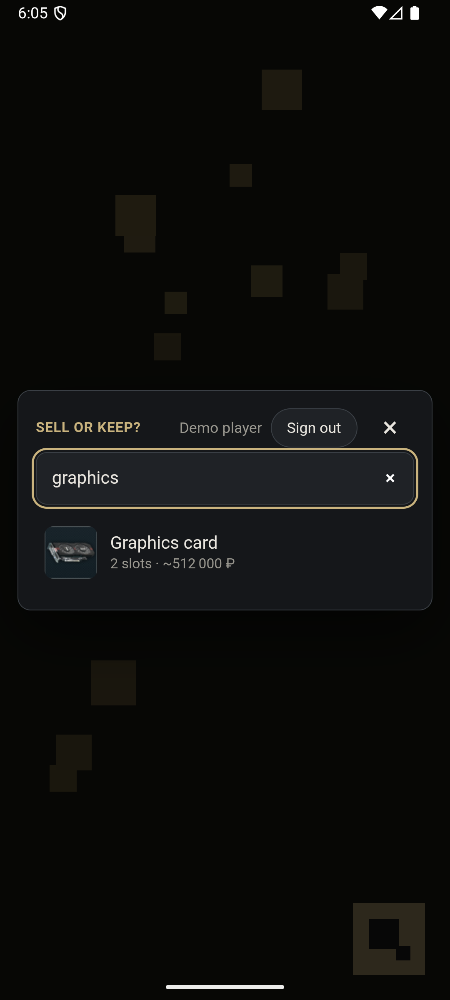
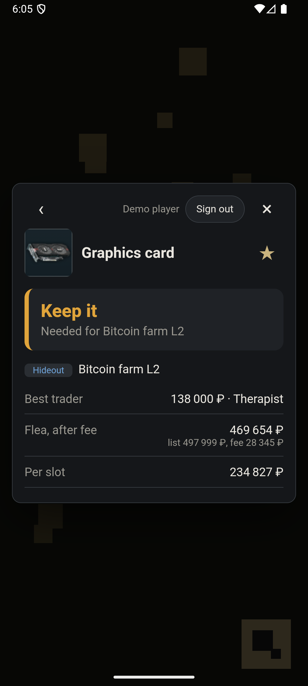

# Tarkov Companion SDK

An embeddable Android SDK, with a headless iOS layer over the same core on a separate branch, that answers one question for an Escape from Tarkov player, from inside a game, in a few seconds:

> **"Should I sell this item, and where — or keep it?"**

It is built the way a client SDK that ships inside other teams' games has to be built: a C++ core behind a stable C API, a small Kotlin library with a guarded public API, a web UI flow in a WebView behind a versioned bridge, and a sample C++ "game" that integrates it in ten lines.

<p>


</p>

*The overlay on top of the sample game (portrait, emulator). Graphics card: the flea pays ~470 000 ₽ after fees vs 138 000 ₽ from Therapist, but it's needed for the Bitcoin farm upgrade, so: keep it.*

## The problem, and how we'd know it's solved

After a raid the player has a full backpack and a few seconds of patience. Today the answer takes a second screen, a wiki, a price site, and mental arithmetic for the flea-market fee (it grows superlinearly when you overprice).

**Metric: time from tapping the companion button to the first verdict** (`time_to_first_verdict_milliseconds` in [analytics](docs/analytics.md)). Target: p75 under 3 s. On the emulator a verdict after the search takes 0.3–0.8 s including the hideout fetch; the rest is typing.

The verdict accounts for:

- best trader offer vs. flea market **after the listing fee** (Intelligence Center discount included)
- whether the flea is unlocked for this player (level 15) and whether the item is flea-banned
- quests and hideout upgrades that still need the item → **keep**
- price per inventory slot, and how stale the prices are

## Architecture

```
┌──────────────────────── host game (C++ / NativeActivity) ─────────────────────────┐
│  game loop ── tap ──► JNI ──► GameActivity.openCompanionFromNative()              │
│                                        │                                          │
│  ┌─────────────────────── sdk-android (Kotlin, AAR) ─────────────────────────┐    │
│  │  TarkovCompanion (public API)   HttpTransport / Logger / Analytics (SPI)  │    │
│  │      │                                                                    │    │
│  │  CompanionActivity ── WebView ◄── MessageChannel (bytes, unread) ── web-ui│    │
│  │      │                         (https://appassets.androidplatform.net)    │    │
│  │  SessionDriver: runs actions ── http → HttpTransport, cache → disk,       │    │
│  │      ▲   │      result → callback, bridge_send → page, track → Analytics  │    │
│  │      │   ▼   JNI (RegisterNatives, UTF-8 byte[])                          │    │
│  │  core (C++17), C API tarkov_companion_session_*, sans-IO state machine    │    │
│  │    session: GraphQL requests · network-first, cache fallback · hideout    │    │
│  │             refresh · cancellation · settings from config-limits.json     │    │
│  │    bridge:  protocol v1 · handshake · validation · supersede · analytics  │    │
│  │    flags:   remote flags & kill switch · fetched, cached, applied here    │    │
│  │    auth:    OAuth 2.0 + PKCE · refresh & rotation · tokens never leave it │    │
│  │    favorites: local first · per-item LWW · offline queue · account sync   │    │
│  │    catalog: static fallback when tarkov.dev is down · shard search        │    │
│  │    engine:  JSON parser · flea-fee formula · recommender · LRU+TTL        │    │
│  └───────────────────────────────────────────────────────────────────────────┘    │
└───────────────────────────────────────────────────────────────────────────────────┘
```

Everything that knows about tarkov.dev, the web UI's protocol, the remote flags, the sign-in flow, favourites sync or the fallback catalog is in the core. The platform layer only executes what the core asks for, carries the page's messages unread, and owns the WebView and the screen's lifecycle. That is what makes a second platform cheap ([ADR 0006](docs/adr/0006-sans-io-session.md), [0007](docs/adr/0007-bridge-protocol-in-core.md), [0008](docs/adr/0008-remote-flags-and-analytics-catalog.md), [0009](docs/adr/0009-sign-in.md), [0010](docs/adr/0010-favorites-sync.md), [0011](docs/adr/0011-static-catalog.md)).

**iOS** (on the [`ios` branch](https://github.com/AlekseyAzarov/tarkov-companion/tree/ios/); [guide](docs/ios.md), [ADR 0013](docs/adr/0013-ios-headless-layer.md)): a Swift package runs the same core, unchanged, built as an XCFramework. It offers the headless API (search and verdicts, with the offline cache and the catalog fallback) and is tested in CI on the iOS simulator against the same recorded responses and golden verdict as Android. The overlay, sign-in and favourites are Android-only so far. It lives on its own branch and is not merged into `main`.

**Sign-in** ([guide](docs/auth.md)): players sign in with the game's own identity server over OAuth 2.0 with PKCE, in the system browser, never in the SDK's WebView. Tokens are refreshed and rotated in the core, kept encrypted under an Android Keystore key, and never reach the web page, the logs or analytics.

**Favourites** ([guide](docs/favorites.md)): kept on the device and editable offline; for signed-in players, synced across devices through the game's backend, per item by the time of the player's change. Item names come from the SDK's own tarkov.dev data, never from the page.

**When tarkov.dev's API is down** ([catalog](docs/catalog.md)): its GraphQL API has been down since July 2026. Every hour, a job cuts tarkov.dev's JSON datasets into small static files on GitHub Pages, in the shapes of the GraphQL responses; the SDK falls back to them, about 0.6 KB per search instead of the datasets' 2.3 MB.

| Directory | What |
|---|---|
| [`core/`](core) | C++17 business logic, C API ([`tarkov_companion.h`](core/include/tarkov_companion/tarkov_companion.h)), GoogleTest suite |
| [`sdk-android/`](sdk-android) | Kotlin library: public API, JNI glue, session executor, disk store, WebView host |
| [`web-ui/`](web-ui) | Preact + TypeScript flow shown in the WebView, typed bridge client, vitest |
| [`bff/`](bff) | Development backend: a minimal OAuth 2.0 authorization server (PKCE, rotating refresh tokens) and a favourites sync endpoint, for trying both end to end. Node built-ins only; not for production |
| [`host-game/`](host-game) | Sample "game": C++ render loop on NativeActivity, two flavors for footprint diffs |
| [`sdk-ios/`](https://github.com/AlekseyAzarov/tarkov-companion/tree/ios/sdk-ios) (`ios` branch) | Swift package: the headless API on the core's XCFramework, session driver, disk stores, XCTest suite |
| [`experiments/flutter_overlay/`](experiments/flutter_overlay) | The same screen in Flutter, built only to measure it against the WebView ([ADR 0002](docs/adr/0002-webview-vs-flutter.md)); not part of the SDK or CI |
| [`contracts/`](contracts) | GraphQL queries, settings limits and the analytics event catalog (single source for C++/Kotlin codegen and the live check), recorded fixtures |
| [`docs/`](docs) | ADRs, integration guide, troubleshooting, bridge protocol, analytics, footprint |

## Integration (host side)

```kotlin
// Application.onCreate
TarkovCompanion.initialize(this, CompanionConfig.Builder().httpTransport(myTransport).build())
TarkovCompanion.setPlayerProfile(PlayerProfile.Builder().level(22).intelligenceCenterLevel(1).build())

// pause menu button
TarkovCompanion.showItemLookup(activity)
```

The complete sample integration is [one file](host-game/src/withSdk/kotlin/com/tarkovcompanion/hostgame/CompanionIntegration.kt); the C++ side is [`openCompanion()`](host-game/src/main/cpp/game_main.cpp). Full guide: [docs/integration-guide.md](docs/integration-guide.md).

## Engineering for a library that lives in someone else's app

**Backward compatibility**
- Public API snapshot in [`sdk-android/api/`](sdk-android/api/sdk-android.api); CI fails on any unreviewed change (`checkKotlinAbi`). `explicitApi()` mode; builders instead of data classes; internal constructors on result types; Kotlin language/API level 2.2 for older host toolchains.
- One C API surface (`tarkov_companion_session_*`); settings are JSON documents whose keys, limits and defaults are generated for both C++ and Kotlin from [`config-limits.json`](contracts/config-limits.json). Unknown keys are ignored and logged, so an older core works with a newer platform layer.
- Bridge protocol with a two-way version handshake, `unsupported_type` answers for forward compatibility, and remote `minimumWebProtocol` / `disabledBundleVersions` ([spec](docs/bridge-protocol.md)).

**No surprises for the host**
- Zero runtime dependencies besides kotlin-stdlib ([ADR 0003](docs/adr/0003-zero-runtime-dependencies.md)); all network through the host's `HttpTransport`, item icons included.
- `initialize()` does no I/O; native library loaded lazily; background threads at background priority.
- The overlay survives rotation, process death (restores the open item), WebView renderer crashes (the game keeps running), missing WebView providers, and follows the game's orientation.
- Offline: the last good response is served and labelled with its age; a kill switch persists across cold starts without network ([remote flags](docs/remote-flags.md)).

**Small** ([details](docs/footprint.md)): ≈ 375 KB per arm64 device (about 200 KB of it is the session, bridge, flags, sign-in, favourites and catalog logic that would otherwise be rewritten per platform). Found that 118 KB of the native library was libc++abi's demangler and removed it (288 → 117 KB). On iOS the same core links to 230 KB for arm64 devices. Memory: +1 MB until the overlay opens; about +140 MB once it has opened (the WebView in the game's process and its renderer process), measured against a Flutter build of the same screen in [ADR 0002](docs/adr/0002-webview-vs-flutter.md).

**Security of the web boundary** ([ADR 0004](docs/adr/0004-web-message-channel.md)): no `addJavascriptInterface`; origin-checked `MessageChannel`; CSP with `connect-src 'none'`; all navigation blocked; every message size-capped and validated on both sides.

**Upstream API ownership**: tarkov.dev is a community API. Queries live in [`contracts/queries`](contracts/queries) and are compiled into the core; a [nightly job](.github/workflows/contract.yml) runs them live, diffs the response shape against the fixtures, and opens an issue on breakage. Since July 2026 its GraphQL API answers "GraphQL server unavailable" ([the-hideout/tarkov-api#474](https://github.com/the-hideout/tarkov-api/issues/474)), which exercised exactly these paths: the checker reports "unavailable" separately from "contract broken", and the SDK falls back to the [static catalog](docs/catalog.md), then to its cache.

## Tests

| Suite | Where it runs | Count |
|---|---|---:|
| C++ core (GoogleTest): parser, recommender, engine, session flows against a scripted platform, bridge protocol and state machine, protocol transcript, remote flags, analytics catalog, sign-in (PKCE, refresh, rotation, rate limits, sign-out races, forged redirects, token leaks), SHA-256, favourites (merge, conflicts between devices, offline queue), catalog fallback and search rules, settings, C API | host with ASan/UBSan in CI; on Android via [`run-core-tests-on-device.sh`](scripts/run-core-tests-on-device.sh) | 206 |
| Kotlin unit (JVM): session executor (action order on a thread pool, a slow request, failing stores, unreadable actions), bridge connections, sign-in plumbing, favourites plumbing, catalog setting, kill switch verdict, settings documents, action format, analytics catalog check, disk store, redirect scheme | JVM | 51 |
| Instrumented: real `.so`, JNI, golden contract through the session, bridge round trip, remote flags, sign-in, favourites across a restart, Keystore secret store, public API end to end | emulator | 16 |
| Web (vitest): bridge, protocol validators, protocol transcript, formatting | Node | 52 |
| Development server (`node --test`): PKCE, the real form, rotation and reuse detection, revocation, favourites sync (conflicts, limit, clocks ahead), catalog serving | Node | 22 |
| Catalog generator (`node --test`): search rules shared with the core, data mapping, response shapes against the GraphQL fixtures | Node | 11 |
| Contract checker self-test (unchanged / additive / breaking upstream) | Node | 3 |

Two fixtures are contracts between the core and the web UI, tested from both sides: the verdict format ([`core_recommendation.json`](contracts/fixtures/core_recommendation.json), produced byte for byte by the C++ and instrumented tests, accepted by the TypeScript validators) and the bridge protocol as a conversation ([`bridge_transcript.json`](contracts/fixtures/bridge_transcript.json), replayed through the core, every reply accepted by the web side).

## Running it

Requirements: JDK 17+, Android SDK with NDK 29.0.13846066 and CMake 3.22.1, Node 18+.

```bash
./gradlew :host-game:installWithSdkDebug        # sample game; tap the gold button bottom-right
./gradlew :sdk-android:testDebugUnitTest :sdk-android:checkKotlinAbi
./gradlew :sdk-android:connectedDebugAndroidTest
./gradlew footprintReport                        # build/reports/footprint.md
cd web-ui && npm install && npm test && npm run dev   # web flow in a browser with a mock bridge
node scripts/contract-check.mjs                  # live check against tarkov.dev
```

Debug builds of the sample game fall back to the recorded fixtures when tarkov.dev is unreachable ([`DemoSupport.kt`](host-game/src/withSdkDebug/kotlin/com/tarkovcompanion/hostgame/DemoSupport.kt), itself an example of a host-provided `HttpTransport`). Release builds use the network only.

## Decisions

- [0001 — C++ core behind a C API](docs/adr/0001-cpp-core.md)
- [0002 — WebView rather than Flutter or native views](docs/adr/0002-webview-vs-flutter.md)
- [0003 — No runtime dependencies](docs/adr/0003-zero-runtime-dependencies.md)
- [0004 — MessageChannel bridge on a real https origin](docs/adr/0004-web-message-channel.md)
- [0005 — Classic Kotlin plugin until ABI validation supports AGP 9 built-in Kotlin](docs/adr/0005-classic-kotlin-plugin.md)
- [0006 — tarkov.dev logic in a sans-IO core session](docs/adr/0006-sans-io-session.md)
- [0007 — The WebView bridge protocol runs in the core](docs/adr/0007-bridge-protocol-in-core.md)
- [0008 — Remote flags in the core, analytics names in a catalog](docs/adr/0008-remote-flags-and-analytics-catalog.md)
- [0009 — Sign-in with OAuth and PKCE, the flow in the core](docs/adr/0009-sign-in.md)
- [0010 — Favourites, local first, synced through the core](docs/adr/0010-favorites-sync.md)
- [0011 — A static catalog when tarkov.dev's GraphQL API is down](docs/adr/0011-static-catalog.md)
- [0012 — The overlay is an activity of its own, not a view in the game's window](docs/adr/0012-overlay-activity.md)
- [0013 — An iOS layer over the same core, headless first](docs/adr/0013-ios-headless-layer.md)

## Not done yet

- iOS beyond the headless API: the overlay in a `WKWebView` (which has no `MessagePort` to hand to the page, so the bridge needs another transport), sign-in with `ASWebAuthenticationSession` and the Keychain, favourites.

## How AI tools were used

I built this with Claude Code, an AI coding agent. The split was deliberate: I designed the architecture and wrote the skeleton for the parts that make it an SDK for someone else's game, while the agent did the bulk of the actual coding and built everything around them.

**Designed and scaffolded by me (fleshed out by the agent)**

- **The C++ core and its boundary:** the sans-IO session (actions out, completions in), the flat C API and its ownership rules, the JNI glue with `RegisterNatives` and UTF-8 bytes instead of `jstring`.
- **The Android layer and its lifecycle:** the overlay activity (rotation, process death, renderer crashes, `screenOrientation="behind"`), lazy native loading, nothing on the cold-start path in `initialize()`.
- **The WebView boundary:** the `MessageChannel` bridge on a real https origin, the versioned protocol with its handshake, CSP and blocked navigation.
- **Sign-in:** OAuth 2.0 with PKCE in the system browser, refresh and rotation in the core, tokens kept out of the page, logs and analytics.
- **Footprint and API stability:** the size budget and the demangler finding, the public API rules (explicit API mode, a snapshot that CI checks, builders instead of data classes), zero runtime dependencies.
- **Product decisions:** the time-to-first-verdict metric, the kill switch, the offline and fallback-catalog behaviour, and the trade-offs recorded in the ADRs.

**Generated end-to-end by the agent, reviewed by me**

- Documentation: the guides, the ADR texts from my decisions, troubleshooting, the changelog.
- Tests: the GoogleTest, JVM, instrumented and vitest suites, the fakes and the fixtures.
- Much of the research: how tarkov.dev's API and datasets are shaped, the OAuth and Android platform specifics behind my decisions (RFC 8252, Keystore, WebView messaging), the options weighed in the ADRs.
- Supporting modules and tooling: the JSON parser and writer, the codegen from `contracts/`, Gradle and CMake tasks, the web UI's markup and styles, the browser mock bridge for development, the development backend in `bff/`.
- The iOS layer on the `ios` branch: the XCFramework build of the core, the Swift package and its tests, the macOS CI job. With no Mac available, it was compiled and tested only in CI.
- The Flutter comparison: the same screen in Flutter (`experiments/flutter_overlay`), the `withFlutter` build of the sample game, the measuring scripts and the measurements in ADR 0002. Measuring it showed that the WebView's renderer process had never been counted, which turned the memory comparison around.

**Where I caught the agent's mistakes**

- **Flea fee test:** the first version asserted the fee grows with the listing price. I ran the suite on the emulator and it showed the fee doesn't: the formula also punishes listing *below* the base price. The test now checks both directions, with hand-computed values.
- **API snapshot tooling:** the Gradle setup the agent wrote for the snapshot (binary-compatibility-validator) silently did nothing with AGP 9's built-in Kotlin. I found it because the dump was missing, not because anything failed: the reason for [ADR 0005](docs/adr/0005-classic-kotlin-plugin.md).

**Review**

Before publishing I had the agent review the code as a senior engineer on an SDK team would. It found real bugs: platform actions running on two threads out of order (a sign-out could be undone on disk), any 4xx on refresh signing the player out, a sign-out racing a sign-in still finishing. I chose which findings to act on and how; the agent wrote the fixes and the tests that reproduce them, and I ran everything on the emulator. What the code guarantees as a result is described in [auth.md](docs/auth.md) and the [integration guide](docs/integration-guide.md).

## Disclaimer

Fan project for a portfolio. Not affiliated with Battlestate Games; Escape from Tarkov names and item images belong to them. Data comes from the community [tarkov.dev](https://tarkov.dev) API. Not published to any app store.

## License

[MIT](LICENSE)
